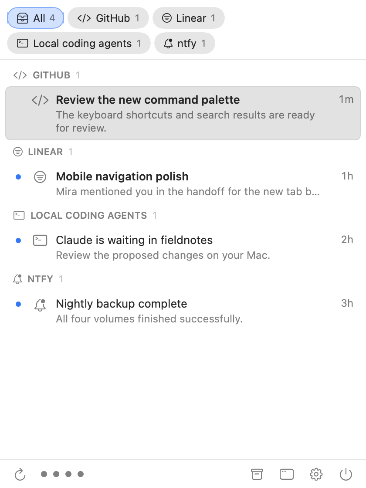
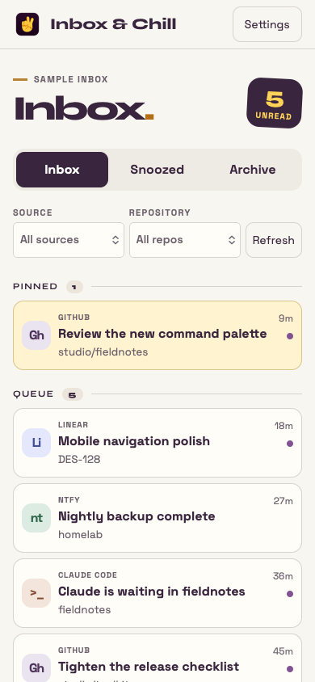

<p align="center"></p>
<h1 align="center">Inbox &amp; Chill</h1>
<p align="center"><strong>One queue for the things that need your attention.</strong></p>
<p align="center">A free, open-source macOS menu bar app with an optional private iPhone companion.</p>

<p align="center">
  <a href="#build-and-install">Install from source</a> ·
  <a href="companion/README.md">iPhone setup</a> ·
  <a href="docs/setup-sources.md">Connect sources</a> ·
  <a href="https://github.com/smcnab1/inbox-and-chill/issues/new/choose">Report an issue</a>
</p>

<p align="center">
  <a href="https://github.com/smcnab1/inbox-and-chill/actions/workflows/ci.yml"></a>
  <a href="LICENSE"></a>
  <a href="#requirements"></a>
</p>

This is Sam McNab’s fork of [Inbox & Chill by Brandon Lucas Green](https://github.com/brandonlucasgreen/inbox-and-chill). It adds an opt-in companion that lets you triage part of your Mac inbox from your iPhone. Install and update this fork from source. Upstream downloads and the upstream Homebrew cask use a separate distribution channel.

<p align="center">
  
  
</p>
<p align="center">Sample inboxes on macOS and iPhone.</p>

## What you can do

- Triage notifications and tasks from the menu bar or open the same queue in a separate window with `⌘0`.
- Open an item in its source, mark it done, snooze it, pin it or restore it from the archive. Actions such as marking a GitHub notification read or snoozing a Linear notification can update the source.
- Fold rows by source context, such as a GitHub repository or Slack channel, and use Topics to group related items across sources.
- Use keyboard shortcuts, Apple Shortcuts or the [`inchill` CLI](docs/shell-integration.md) to act on the queue or add local notifications.

## Supported sources

Add sources in **Settings → Sources** on the Mac. Apple Mail and Reminders use macOS permissions. Local coding agents use local hooks or the CLI.

| On the Mac | What enters the queue |
| --- | --- |
| GitHub, GitLab, Linear, Trello | GitHub notifications, GitLab to-dos, Linear inbox items and Trello notifications |
| Slack, Sentry | Slack mentions, DMs and watched keywords, and Sentry items for review |
| Apple Mail, Apple Reminders, Todoist, Asana | Flagged or unread mail, reminders and assigned tasks |
| ntfy, custom JSON | Notifications from an ntfy topic and items from a mapped JSON feed |
| Local coding agents | Claude Code, Codex and Gemini hooks, plus custom `inchill` producers |

The iPhone companion shows **GitHub, Linear, ntfy and Local coding agents**. Mac-only files and terminal sessions open on the Mac. The inherited GitLab, Trello and Asana connectors have limited live-account verification. [Source setup and per-source details](docs/setup-sources.md)

## Requirements

| Use | Requirements |
| --- | --- |
| Mac app | macOS 15 Sequoia or later |
| Build from source | Full [Xcode 26 or later](https://developer.apple.com/xcode/system-requirements/) with its command-line tools selected, and [XcodeGen](https://github.com/yonaskolb/XcodeGen) |
| iPhone companion | iOS 16.4 or later, Safari, Node.js 22.13 or later on the Mac, and both devices on the same private [Tailscale](https://tailscale.com/) network |

## Build and install

With Xcode and [Homebrew](https://brew.sh/) available, clone the fork and build the direct target. The installer validates the build, places it in `/Applications` and launches it. Xcode 26 requires macOS 15.6 or later on the build Mac.

```sh
git clone https://github.com/smcnab1/inbox-and-chill.git
cd inbox-and-chill
brew install xcodegen
xcodegen generate
xcodebuild -project InboxAndChill.xcodeproj -scheme InboxAndChill \
  -configuration Release -destination 'platform=macOS' -derivedDataPath build/companion-mac \
  CODE_SIGN_IDENTITY=- DEVELOPMENT_TEAM= OTHER_CODE_SIGN_FLAGS=--timestamp=none build
scripts/install-local.sh --app 'build/companion-mac/Build/Products/Release/Inbox & Chill.app'
```

The command uses local ad-hoc signing and requires no Apple Developer membership. macOS may ask for Keychain access again after a rebuild. If you already sign your local installation with your own identity, use that same identity for updates. The fork uses the original bundle identifier and the same application data paths. [Local build and testing notes](docs/testing-locally.md)

## iPhone companion

Enable the companion on the Mac and install the site from Safari as a Home Screen app. The Mac hosts the relay and serves it over HTTPS through **Tailscale Serve**. Pair the phone with a one-time code. You can try a separate sample inbox before connecting live data.

Archive and restore the shared queue, or use **Mark done** to apply the source’s action where available. Optional Web Push uses generic lock-screen text and can update the Home Screen badge. The Mac needs to be awake and logged in, with the app and relay running for live sync and new push alerts. The phone refreshes on foreground and every 30 seconds while the inbox is open. A Mac-side archive or read may leave a background badge stale until the next refresh or push.

[Private setup, push and recovery](companion/README.md) · [Privacy](PRIVACY.md)

## Update

Fetch and review changes from this fork, then rebuild and run the Mac installer again. For the companion, rerun `scripts/install-companion-relay.sh` with your **existing HTTPS origin and port** and reopen the Home Screen app. Keeping the same origin and relay data preserves the pairing. The fork’s direct build has upstream Sparkle updates disabled. [Update instructions](companion/README.md#update-an-existing-install)

## Contribute

[Contributing and syncing upstream](CONTRIBUTING.md) · [Security reporting](SECURITY.md) · [Third-party notices](THIRD_PARTY_NOTICES.md)

Inbox & Chill is distributed under the [MIT licence](LICENSE). Copyright © 2026 Brandon Lucas Green. The upstream project and original brand attribution are preserved.
